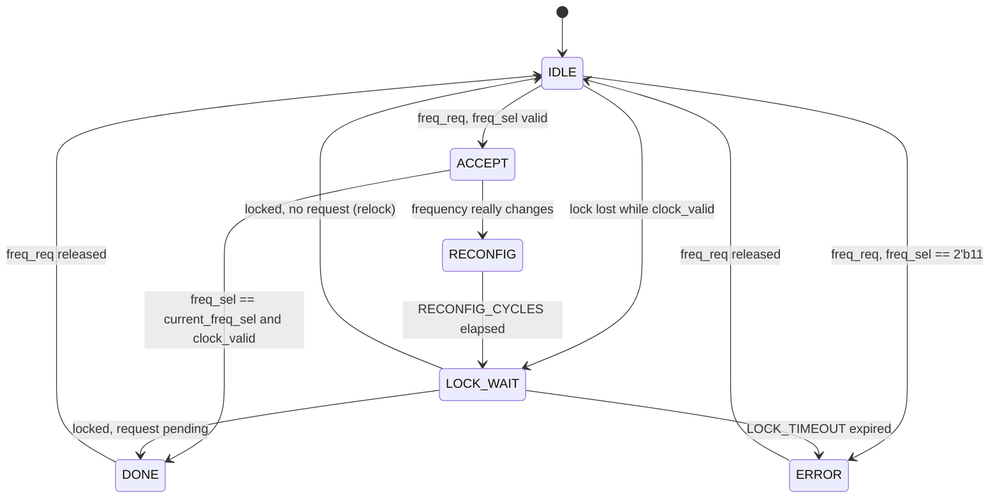

# P1 — Reconfigurable PLL architecture

> **Status: Session 1 of P1. Control logic only.**
> `rtl/p1_pll_controller.v` is synthesizable Verilog-2001 with no `#` delays
> and no clock generation. It passes 49 of 49 directed checks in XSim behavioral
> simulation against a stand-in PLL — see section 8. The behavioral PLL and
> `gpu_clk` do not exist yet; they are Session 2, and nothing here has been
> simulated against a calibrated clock model.

The interface contract lives in
[`p1_pll_interface.md`](p1_pll_interface.md). This document covers the internal
architecture.

---

## 1. Split of responsibilities

P1 is deliberately two pieces:

| Piece | File | Nature | Session |
|-------|------|--------|---------|
| Frequency transition controller | `rtl/p1_pll_controller.v` | synthesizable RTL, control only | 1 (this one) |
| Behavioral PLL / clock model | not yet written | simulation only, Cadence-calibrated | 2 |

The boundary between them is three signals: `pll_reconfig_en` and
`pll_freq_code` out, `pll_lock_in` back. The controller knows nothing about
divider ratios, lock time or output frequency, so the model can be recalibrated
against Cadence results without any RTL change.

The controller is the part that must survive synthesis. The model never will.
Keeping them in separate files is what makes that possible.

---

## 2. Module hierarchy

### This session

```
p1_pll_controller          (synthesizable, clocked by clk_ref)
```

No submodules. The two-flop lock synchroniser is inline.

### Expected after Session 2

```
p1_pll_top                      (wrapper, Session 2)
├── p1_pll_controller           (this module, unchanged)
└── p1_pll_behavioral           (simulation-only clock model, Session 2)
        -> gpu_clk
```

`gpu_clk` leaves the wrapper, not the controller. The controller never sees it.

---

## 3. Why the control logic is not on `gpu_clk`

`gpu_clk` is the clock being reconfigured. During reconfiguration it stops,
changes period, or glitches. An FSM clocked by it would lose the ability to
sequence its own recovery exactly when it is needed, and a lock timeout
measured in `gpu_clk` cycles would be meaningless when `gpu_clk` has stopped.

So every register in the controller is on `clk_ref`, which is unaffected by
reconfiguration. The only signal crossing in from the PLL is `pll_lock_in`, and
it is synchronised:

```verilog
always @(posedge clk_ref or negedge rst_n) begin
    if (!rst_n) begin
        lock_meta <= 1'b0;
        lock_sync <= 1'b0;
    end
    else begin
        lock_meta <= pll_lock_in;
        lock_sync <= lock_meta;
    end
end
```

Every FSM decision uses `lock_sync`, never `pll_lock_in`.

---

## 4. FSM

Six states, encoded as `localparam [2:0]`.

| State | Encoding | Purpose |
|-------|----------|---------|
| `IDLE` | `3'd0` | Wait for `freq_req`. Also where initial bring-up and loss of lock are detected. |
| `ACCEPT` | `3'd1` | Request acceptance. Decide whether the PLL actually has to move. |
| `RECONFIG` | `3'd2` | Hold `pll_reconfig_en` and the new `pll_freq_code` at the PLL for `RECONFIG_CYCLES` cycles. |
| `LOCK_WAIT` | `3'd3` | Wait for `lock_sync`, with the `LOCK_TIMEOUT` counter armed. |
| `DONE` | `3'd4` | Completion. Commit the new operating point, pulse `freq_ack`, hold `pll_done`. |
| `ERROR` | `3'd5` | Error recovery. Sticky `pll_error` is already set; wait for the requester to release `freq_req`. |



Structure follows P3: one clocked process for `state` and the datapath, one
combinational process for `next_state`, one combinational process for the
status outputs. Reset is asynchronous and active-low in every process.

### Registers

| Register | Width | Purpose |
|----------|-------|---------|
| `state` | 3 | FSM state |
| `target_sel` | 2 | Latched request, sampled only in `IDLE` |
| `req_pending` | 1 | Distinguishes a requested transition from an unrequested relock |
| `wait_count` | 16 | Dwell counter, reused by `RECONFIG` and `LOCK_WAIT` |
| `lock_meta`, `lock_sync` | 1 each | Lock synchroniser |
| `pll_freq_code` | 2 | Code presented to the PLL, updated only on a real change |
| `current_freq_sel` | 2 | Last established code, committed in `DONE` |
| `clock_valid` | 1 | Generated clock usable |
| `pll_error` | 1 | Sticky error |
| `freq_ack` | 1 | One-shot completion pulse |

`wait_count` is a fixed 16-bit counter rather than a `$clog2`-sized one, so the
module stays inside Verilog-2001. `p3_persistence_counter` uses `$clog2`, which
is Verilog-2005; P1 avoids that question. The consequence is that
`LOCK_TIMEOUT` must be below 65536.

### `req_pending`

This is the one piece of state that is easy to miss. `LOCK_WAIT` is entered
from two different places:

- from `RECONFIG`, as part of a request from P3 — completion must be
  acknowledged;
- from `IDLE`, after an unrequested loss of lock — there is nothing to
  acknowledge, and emitting `freq_ack` would look to a PMU like a transition it
  never asked for.

`req_pending` is set when `IDLE` latches a valid request and cleared in `DONE`
and `ERROR`. On lock, `LOCK_WAIT` goes to `DONE` if it is set and straight back
to `IDLE` if it is not.

### No duplicate acknowledgements

```verilog
freq_ack <= (next_state == DONE) && (state != DONE);
```

`freq_ack` is a registered one-shot asserted on the transition *into* `DONE`.
`DONE` can hold for many cycles while `freq_req` is still high, but the pulse
fires only on entry, and `DONE` is entered once per accepted request. The
testbench counts pulses and also fails if `freq_ack` is ever high for two
consecutive cycles.

### Counter reuse

```verilog
if (next_state != state)
    wait_count <= 16'd0;
else if (state == RECONFIG || state == LOCK_WAIT)
    wait_count <= wait_count + 16'd1;
```

Clearing on every state entry means `RECONFIG` and `LOCK_WAIT` can share one
counter without interfering.

---

## 5. Validity of `clock_valid`

`clock_valid` means *the generated clock is locked and running at
`current_freq_sel`*. It is the signal a clock gate or a downstream block should
use, not `pll_locked`, which is only the raw lock bit.

It is set:

- in `DONE`, on any successful completion;
- in `IDLE`, when the PLL reports lock **and** `pll_freq_code` equals
  `current_freq_sel`.

It is cleared:

- on reset;
- when leaving `ACCEPT` for `RECONFIG`, before the PLL is disturbed;
- on loss of lock in `IDLE`.

The `pll_freq_code == current_freq_sel` guard in the second set condition is
what keeps the signal honest. After a lock timeout, `pll_freq_code` holds the
code that failed while `current_freq_sel` still holds the last good one. If the
PLL later locks on its own, it is locked at the *failed* code, so P1 must not
claim the reported frequency is valid. The guard blocks that and forces a fresh
request. After reset, and after a plain relock, the two are equal and the
adoption is correct.

---

## 6. Timing of a transition

With `RECONFIG_CYCLES = 4`, a lock latency of L synchronised cycles and no
error, counted in `clk_ref` cycles from the edge on which `freq_req` is first
sampled high:

| Cycle | State | `pll_busy` | `pll_done` | `clock_valid` |
|-------|-------|------------|------------|---------------|
| 0 | `IDLE` -> `ACCEPT` | 0 | 0 | previous value |
| 1 | `ACCEPT` | 1 | 0 | previous value |
| 2 | `RECONFIG` | 1 | 0 | 0 |
| 3-5 | `RECONFIG` | 1 | 0 | 0 |
| 6 | `LOCK_WAIT` | 1 | 0 | 0 |
| 6+L | `DONE` | 0 | 1 | 1 |
| 6+L | `freq_ack` pulse, one cycle | | | |
| after `freq_req` falls | `IDLE` | 0 | 0 | 1 |

A same-state request short-circuits `ACCEPT` straight to `DONE`, so `pll_done`
rises two cycles after `freq_req` and `clock_valid` never drops. That two-cycle
minimum is the guarantee P3's `pll_seen_busy` qualification relies on: `pll_done`
is low on at least two consecutive `posedge clk_ref` samples after `freq_req`
rises.

---

## 7. What is deliberately absent

- **No frequency values.** No megahertz, no divider or multiplier ratios, no
  VCO parameters. They are Cadence calibration outputs.
- **No clock generation.** No `gpu_clk`, no `always #N` toggling, no
  `$realtime` arithmetic. The RTL contains no `#` delays at all.
- **No clock gate or glitch-free mux.** Whether the GPU clock needs to be gated
  off during reconfiguration is a Session 2 question that depends on what the
  calibrated model actually does to its output.
- **No voltage awareness.** P4's rail is P3's business. P1 only reports whether
  the clock it generates is usable.
- **No changes to P2, P3 or P4.** Nothing outside `P1_PLL/` was touched.

---

## 8. Verification status

AMD Vivado Simulator (XSim) v2026.1, behavioral simulation. **49 checks, 49
passes, 0 failures**, finishing at 1380 ns, well inside the 50 us watchdog. No
elaboration warnings. Full transcript:
[`../simulation/p1_controller_sim_output.txt`](../simulation/p1_controller_sim_output.txt).

```
PASS = 49  FAIL = 0
ALL P1 CONTROLLER TESTS PASSED
```

`tb/tb_p1_pll_controller.v` covers ten groups:

| Test | Covers | Result |
|------|--------|--------|
| 1 | Outputs quiet in reset | 7/7 |
| 2 | Initial bring-up at the reset code, with no `freq_ack` | 4/4 |
| 3 | A normal LOW to HIGH transition, exactly one `freq_ack` | 7/7 |
| 4 | Same-state request completes without asserting `pll_reconfig_en` | 4/4 |
| 5 | Reserved `2'b11` rejected, PLL untouched, `clock_valid` preserved | 5/5 |
| 6 | `err_clear` clears the sticky error | 1/1 |
| 7 | Lock timeout, error raised, operating point not committed | 5/5 |
| 8 | The same request succeeds once the PLL can lock again | 4/4 |
| 9 | Reset asserted mid-transition | 6/6 |
| 10 | Loss of lock in steady state, automatic relock, no spurious `freq_ack` | 6/6 |

Continuous monitors run for the whole simulation and fail on a `freq_ack` lasting
two cycles, `pll_busy` and `pll_done` high together, or `freq_ack` without
`pll_done`. None fired.

A structural lint was also run over both source files: block and keyword
balance, absence of `#` delay controls in the synthesizable RTL, absence of
blocking assignments inside clocked blocks, and all 15 controller ports
connected in the testbench instantiation. All pass.

The PLL in the testbench is a **clocked, level-sensitive stand-in**, not the
Session 2 model. This follows the lesson recorded in P3's README section 5:
modelling a responder with `always @(posedge request)` races against the DUT's
combinational outputs and gives scheduling-dependent results.

### What this does and does not establish

Every behaviour described in sections 4 to 6 above is now a simulation result,
not design intent. Not yet covered:

- **Any real clock.** `gpu_clk` does not exist, so nothing checks that the
  generated clock period actually changes, or that it is unusable exactly while
  `clock_valid` is low. That is Session 2's job.
- **`RECONFIG_CYCLES` and `LOCK_TIMEOUT` other than 4 and 32.** The production
  default `LOCK_TIMEOUT = 1024` is never instantiated, and neither is
  `LOCK_TIMEOUT = 0`, the documented "wait indefinitely" mode.
- **`RECONFIG_CYCLES = 1`**, the degenerate single-cycle reconfiguration path.
- **Integration with P3.** The testbench drives P1 directly. No simulation wires
  `p3_dvfs_controller` to `p1_pll_controller`, so the claim that P3's
  `pll_seen_busy` qualification is satisfied is argued from the two-cycle
  `pll_done` guarantee, not measured.
- **A request arriving as a single-cycle pulse** rather than held until
  `pll_done`.
- **Lock lost during `DONE`**, while P3 still holds `freq_req`. By inspection P1
  detects it one cycle later, on entry to `IDLE`.
- **Any synthesis, timing or gate-level run.** Behavioral only.
- **Metastability.** The synchroniser is present but a functional simulation
  cannot exercise it.

### Reproducing

From `P1_PLL/simulation/`, with Vivado's `bin` on `PATH`:

```bash
sh run_xsim.sh
```

This is the flow that produced the transcript. The project-based flow,

```bash
vivado -mode batch -source run_sim.tcl
```

was **not** successfully run here: Vivado's `launch_simulation` spawns its
generated `compile.bat` by bare name, which fails in a shell where
`NoDefaultCurrentDirectoryInExePath=1`. P3's committed `run_sim.tcl` fails the
same way in the same shell, so this is an environment property and not a fault
in either script.

---

## 9. What Session 2 must implement

1. **`p1_pll_behavioral.v`** — simulation-only clock model. Consumes
   `pll_reconfig_en` and `pll_freq_code`, drops `pll_lock_in` on
   reconfiguration, generates `gpu_clk` at the period for that code, and
   reasserts `pll_lock_in` after the calibrated lock time.
2. **The code-to-period table**, calibrated against Cadence. This is where
   frequency values enter the project for the first time, and they must be
   agreed with P3 and P2 because they fix what LOW, MEDIUM and HIGH mean.
3. **Calibrated `RECONFIG_CYCLES` and `LOCK_TIMEOUT`** for this module. The
   current values, 4 and 1024, are placeholders.
4. **`p1_pll_top.v`** — wrapper instantiating the controller and the model, and
   exporting `gpu_clk`.
5. **An integrated testbench** driving the wrapper and measuring `gpu_clk`
   period before and after a transition, including a check that `clock_valid`
   is low for the whole interval in which `gpu_clk` is unusable.
6. **Decide whether `gpu_clk` must be gated** during reconfiguration, and if so
   add a glitch-free gate in the wrapper, not in the controller.
7. **Resolve the open interface questions** in
   [`p1_pll_interface.md`](p1_pll_interface.md) section 9 with the P3 owner —
   especially question 1, the deadlock between P1's error state and P3's lack of
   an error input. That one needs a change on the P3 side and cannot be fixed
   inside P1.
