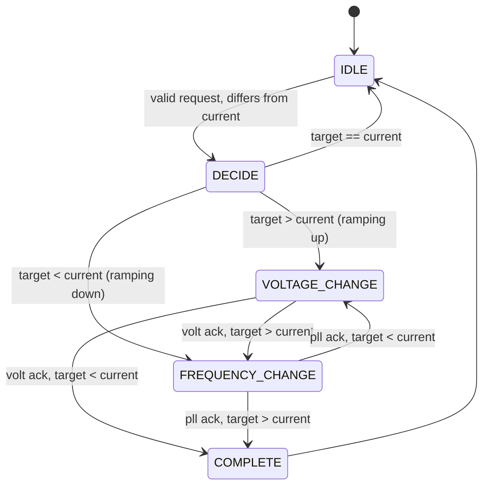
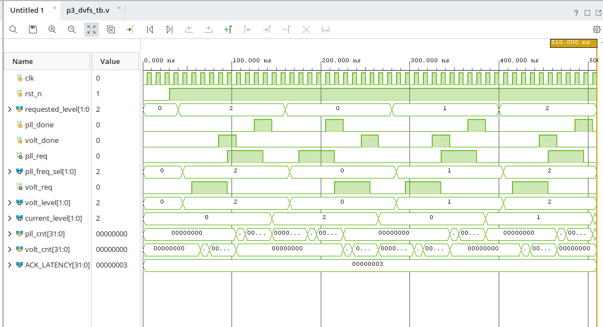

# P3 — DVFS Controller (FSM Design)

Sub-block **P3** of the [GPU_DVFS](../README.md) project.

P3 owns the *sequencing policy*. Given a requested performance level from the
workload monitor (P2), it drives the voltage regulator (P4) and the PLL (P1) in
the order that keeps the GPU electrically safe at every instant.

P3 does not generate clocks and does not regulate voltage. It issues *requests*
and waits for *acknowledgements*.

---

## 1. Module interface

```verilog
module p3_dvfs_controller (
    input  wire       clk,
    input  wire       rst_n,
    input  wire [1:0] requested_level,
    input  wire       pll_done,
    input  wire       volt_done,
    output reg        pll_req,
    output reg  [1:0] pll_freq_sel,
    output reg        volt_req,
    output reg  [1:0] volt_level,
    output reg  [1:0] current_level
);
```

### Inputs

| Signal | Width | Source | Description |
|--------|-------|--------|-------------|
| `clk` | 1 | system | Controller clock. State updates on `posedge clk`. |
| `rst_n` | 1 | system | Asynchronous active-low reset. |
| `requested_level` | 2 | P2 | Requested performance level. |
| `pll_done` | 1 | P1 | PLL acknowledgement — locked at the new frequency. |
| `volt_done` | 1 | P4 | Regulator acknowledgement — rail settled. |

### Outputs

| Signal | Width | Destination | Description |
|--------|-------|-------------|-------------|
| `pll_req` | 1 | P1 | Asserted while a frequency change is requested. |
| `pll_freq_sel` | 2 | P1 | Target frequency encoding. |
| `volt_req` | 1 | P4 | Asserted while a voltage change is requested. |
| `volt_level` | 2 | P4 | Target voltage encoding. |
| `current_level` | 2 | P2 / status | Last **completed** performance level. |

`pll_req` and `volt_req` are combinational decodes of the current state, so each
is asserted for the whole duration of its state. `pll_freq_sel` and `volt_level`
both follow the latched `target_level`.

Handshake protocol and open integration questions are documented separately in
[`docs/interface_assumptions.md`](docs/interface_assumptions.md).

---

## 2. Performance levels

| Encoding | Level | Meaning |
|----------|-------|---------|
| `2'b00` | LOW | Lowest voltage, lowest frequency |
| `2'b01` | MEDIUM | Intermediate operating point |
| `2'b10` | HIGH | Highest voltage, highest frequency |
| `2'b11` | — | Reserved / invalid, explicitly ignored |

A request of `2'b11` is filtered in `IDLE` and never starts a transition.

---

## 3. FSM architecture

Five states, encoded as `localparam [2:0]`:

| State | Encoding | Purpose |
|-------|----------|---------|
| `IDLE` | `3'd0` | Wait for a valid `requested_level` that differs from `current_level`. Latch it into `target_level`. |
| `DECIDE` | `3'd1` | Compare `target_level` against `current_level` and choose the ordering. |
| `VOLTAGE_CHANGE` | `3'd2` | Assert `volt_req`, wait for the P4 handshake. |
| `FREQUENCY_CHANGE` | `3'd3` | Assert `pll_req`, wait for the P1 handshake. |
| `COMPLETE` | `3'd4` | Commit `current_level <= target_level`, return to `IDLE`. |



A conventional two-process FSM: one clocked process for `state` and the
datapath registers, one combinational process for `next_state`, and a third
combinational process for the request outputs.

### Handshake qualification

An acknowledgement is accepted only after the request has been observed *busy*.
Two sticky flags enforce this:

```verilog
if (state == VOLTAGE_CHANGE) begin
    if (!volt_done) volt_seen_busy <= 1'b1;
end
else volt_seen_busy <= 1'b0;
```

`VOLTAGE_CHANGE` advances only on `volt_seen_busy && volt_done`, and
`FREQUENCY_CHANGE` only on `pll_seen_busy && pll_done`. This stops a stale
`*_done` left asserted from the previous transition being mistaken for the
acknowledgement of the current one. The flags clear whenever the FSM leaves the
corresponding state.

---

## 4. Safe DVFS sequencing

Frequency and voltage have an asymmetric safety relationship. A circuit can
always run **slower than** the speed its supply voltage permits, but never
**faster**.

### Increasing performance — voltage first, then frequency

```
IDLE -> DECIDE -> VOLTAGE_CHANGE -> FREQUENCY_CHANGE -> COMPLETE
```

Raise the supply first so the logic can meet timing at the higher clock.
Raising the clock first would leave the GPU briefly running fast on a supply too
low to sustain it, causing setup violations and silent data corruption.

### Decreasing performance — frequency first, then voltage

```
IDLE -> DECIDE -> FREQUENCY_CHANGE -> VOLTAGE_CHANGE -> COMPLETE
```

Lower the clock first so the circuit is already slow enough by the time the
supply drops. Dropping the voltage first would again leave the GPU running at a
clock its supply can no longer support.

In both directions the FSM occupies exactly one of `VOLTAGE_CHANGE` or
`FREQUENCY_CHANGE` at a time, so `pll_req` and `volt_req` are mutually exclusive
by construction. The testbench checks this on every clock edge.

---

## 5. Testbench

`tb/p3_dvfs_tb.v` instantiates the controller and models P1 and P4.

The responders are **clocked and level-sensitive**: each counts `ACK_LATENCY`
(default 3) clock cycles after its request goes high, raises its `*_done`, and
clears it once the request is released. They use non-blocking assignments and
are sensitive to `posedge clk`, not to the request signal itself. This matters —
modelling them as `always @(posedge volt_req)` races against the controller's
combinational request outputs and gives scheduling-dependent results.

### Checks performed

- Correct ordering for a rising transition (voltage before frequency).
- Correct ordering for a falling transition (frequency before voltage).
- `volt_level` and `pll_freq_sel` match the requested level.
- The other request is not already active when one is issued.
- `pll_req` and `volt_req` are never both high (checked every `posedge clk`).
- Neither request is still active after `current_level` updates.
- A 5 us watchdog fails the run if the FSM stalls.

### Stimulus sequence

| Time | Transition | Expected order |
|------|------------|----------------|
| 40 ns | LOW to HIGH | voltage, then frequency |
| 160 ns | HIGH to LOW | frequency, then voltage |
| 280 ns | LOW to MEDIUM | voltage, then frequency |
| 400 ns | MEDIUM to HIGH | voltage, then frequency |

---

## 6. Simulation results

AMD Vivado Simulator (XSim) v2026.1, behavioral simulation.

```
Time 40000: Request level 10
Voltage requested first
Frequency requested second
PASS: Current level = 10
Time 160000: Request level 00
Frequency requested first
Voltage requested second
PASS: Current level = 00
Time 280000: Request level 01
Voltage requested first
Frequency requested second
PASS: Current level = 01
Time 400000: Request level 10
Voltage requested first
Frequency requested second
PASS: Current level = 10
==========================
ALL BASIC DVFS TESTS PASSED
==========================
$finish called at time : 510 ns
```



In the waveform, `current_level` steps `0 → 2 → 0 → 1 → 2`, and `volt_req` and
`pll_req` are never high at the same time.

### What this does and does not establish

All four stimulus transitions completed with the expected ordering and no
assertion fired. The run reaches `$finish` at 510 ns rather than hitting the
watchdog.

This is **basic directed testing only**, not a verification sign-off. Not yet
covered:

- Back-to-back requests with no idle gap between transitions.
- A new `requested_level` arriving mid-transition.
- The reserved `2'b11` level (the FSM filters it, but no test exercises that).
- Reset asserted in the middle of a handshake.
- An acknowledgement arriving in the same cycle as the request (zero latency),
  or never arriving at all.
- Any timing, synthesis or gate-level verification — this is behavioral only.

One elaboration warning is present and understood to be benign:

```
WARNING: [XSIM 43-4328] p3_dvfs_tb.v Line: 144 : Sensitivity on input argument
"new_level" of task "run_change" may never get triggered.
```

`wait (current_level == new_level)` re-evaluates when `current_level` changes,
which is the operand that actually moves during the wait.

---

## 7. Running the testbench in Vivado

### Option A — Vivado GUI

1. Create a new RTL project, or open an existing one.
2. Add `rtl/p3_dvfs_controller.v` to **Design Sources**.
3. Add `tb/p3_dvfs_tb.v` to **Simulation Sources**.
4. Set `p3_dvfs_tb` as the simulation top
   (right-click the file → *Set as Top*, in the Simulation Sources tree).
5. `Flow Navigator` → `SIMULATION` → `Run Simulation` →
   `Run Behavioral Simulation`.
6. Read the result in the **Tcl Console**. The waveform view opens
   automatically; add `dut.state` to see the FSM transitions.

Expected result: four `PASS: Current level = ...` lines followed by
`ALL BASIC DVFS TESTS PASSED`, finishing at 510 ns.

### Option B — XSim command line, no project

With Vivado's `bin` directory on `PATH`, from `P3_DVFS_Controller/`:

```bash
xvlog --relax rtl/p3_dvfs_controller.v tb/p3_dvfs_tb.v
xelab --debug typical --relax -top p3_dvfs_tb -snapshot p3_dvfs_tb_sim
xsim p3_dvfs_tb_sim -runall
```

---

## 8. Directory layout

```
P3_DVFS_Controller/
├── rtl/
│   └── p3_dvfs_controller.v      # Five-state DVFS controller FSM
├── tb/
│   └── p3_dvfs_tb.v              # Testbench with P1/P4 models
├── simulation/
│   └── dvfs_waveform.png         # Behavioral simulation waveform
├── docs/
│   └── interface_assumptions.md  # Provisional P1/P4 interface, open questions
└── README.md
```

---

## 9. Status and next steps

RTL complete. Behavioral simulation passes the directed tests above.

Planned:

- Extend the testbench to cover the gaps in section 6.
- Resolve the open items in
  [`docs/interface_assumptions.md`](docs/interface_assumptions.md) with the P1,
  P2 and P4 owners — particularly whether `pll_done` and `volt_done` need
  synchronisers.
- Decide whether a timeout / error path is required.
- Synthesis and timing closure on the target device.
